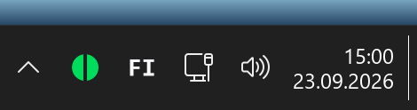
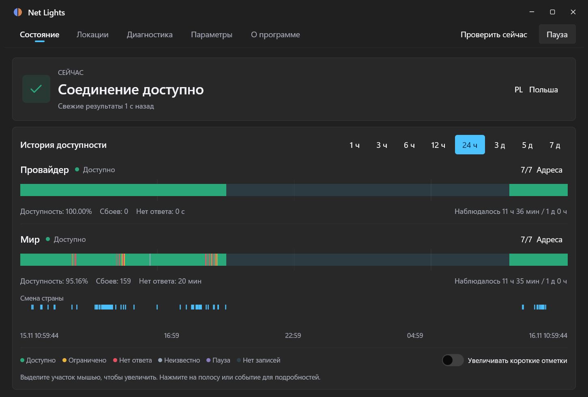
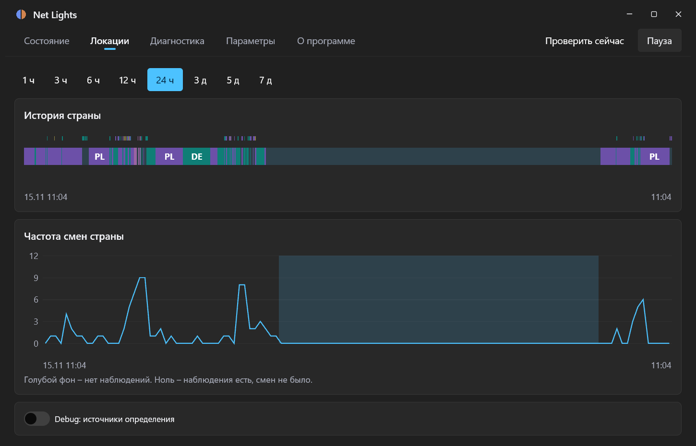

  

<h1 align="center">Net Lights</h1>

  <strong>Доступность сети и история страны вашего IP – в трее Windows.</strong> 
  Круг из двух половин: слева провайдер, справа мир.

  
  
  
  

  <a href="https://github.com/AryaPaw/net-lights/releases/download/v1.7.0/NetLights-Setup-win-x64-1.7.0.exe"><strong>Скачать для Windows</strong></a>
  &nbsp;|&nbsp; <a href="#возможности">Возможности</a>
  &nbsp;|&nbsp; <a href="#установка">Установка</a>
  &nbsp;|&nbsp; <a href="docs/DEVELOPMENT.md">Разработчикам</a>

## Главное – в трее

Не нужно держать окно открытым: состояние двух групп контрольных адресов видно на одном кружке. Левая половина – **провайдер**, правая – **мир**. Их цвета меняются независимо, поэтому сразу видно, в каком направлении появились проблемы.

  

<em>Иллюстрация: обе группы доступны, страна публичного IP – Финляндия (FI).</em>

### Цвет каждой половины

| Цвет | Что означает |
| --- | --- |
|  **Зелёный** | Доступно: не меньше двух независимых подтверждений. |
|  **Жёлтый** | Ограничено: только одно независимое подтверждение. |
|  **Красный** | Нет ответа от контрольных адресов. |
|  **Серый** | Недостаточно свежих данных для определения состояния. |
|  **Голубой** | Пауза: проверки приостановлены, обе половины голубые. |

Показ страны включается отдельно в параметрах. Он помогает заметить смену выхода VPN без открытия окна; подробная история доступна на вкладке «Локации». Нажатие на кружок открывает сводку и графики.

  

## Возможности

| | Что показывает Net Lights |
| --- | --- |
| **Два направления** | Отдельные группы контрольных адресов «Провайдер» и «Мир». Обе группы видны на одном значке в трее. |
| **История доступности** | Общая временная ось, длительность сбоев, охват наблюдений и события с подробностями. Восемь периодов от часа до семи дней. |
| **Смена страны** | Страна публичного IP, история наблюдений и график частоты смен. Можно сопоставить переключение VPN с проблемами доступности. |
| **Диагностика** | Результаты проверок адресов, расширенная диагностика и экспорт. Счётчики трафика помогают разобраться с расходом самой программы. |
| **Управление проверками** | Настраиваемые интервалы доступности и определения страны, свои контрольные адреса и пауза из трея. |
| **Нативное окно** | Rust и GPUI Kit, светлая и тёмная темы, русский и английский языки. Тема и язык могут следовать настройкам Windows. |

### История страны

Полоса стран и график частоты используют один выбранный период. Пропуски наблюдений отличаются от интервалов без смен. Наведение показывает детали; отдельные результаты онлайн-сервиса и локальных баз доступны в свёрнутом разделе Debug.

  

<em>Настоящие окна локальной сборки 1.7.0 на Windows 11. Использована копия реальной истории; IP-адреса не показаны. Изображения не перерисованы.</em>

## Установка

Нужна **Windows 11 x64**. Права администратора и отдельный .NET Runtime не требуются.

1. [Скачайте установщик 1.7.0](https://github.com/AryaPaw/net-lights/releases/download/v1.7.0/NetLights-Setup-win-x64-1.7.0.exe) и запустите его.
2. Нажмите на значок Net Lights в трее, чтобы открыть окно.
3. При необходимости настройте адреса и частоту проверок. Определение страны включается отдельно в параметрах.

Закрытие окна оставляет мониторинг в трее. Для завершения выберите «Выход» в меню значка. Автозапуск и автообновление включены по умолчанию и отключаются в параметрах.

Установки 1.6.0 переходят на новый интерфейс автоматически через промежуточную 1.6.1, сохраняя настройки и историю. Для ручной установки используйте ссылку выше или [список выпусков](https://github.com/AryaPaw/net-lights/releases).

## Как читать показания

На графике пауза обозначена фиолетовым; отсутствие записей имеет отдельный цвет. Цвета статусов в трее описаны в легенде выше.

Проверки HTTPS показывают доступность выбранных адресов, а не всего интернета. Неизвестные интервалы не считаются временем успешной работы. Определение страны относится к публичному IP, а не к физическому местоположению; точное время перехода между опросами неизвестно.

## Данные и приватность

Настройки и обе истории находятся в `%LOCALAPPDATA%\NetLights`. История хранится на диске семь дней и сохраняется между запусками. Записи локаций могут содержать публичный IP; учитывайте это перед передачей файлов другим людям.

Программа обращается к настроенным адресам, GitHub для обновлений и загрузки баз, а при включённом определении страны – к `country.is` и при необходимости резервному `ipwho.is`. Локальные базы V2Fly и IPLocate служат для сравнения в Debug. Net Lights не меняет системные DNS, маршруты и сертификаты.

## Разработка

Инструкции по сборке, единой команде проверки и генерации иконок находятся в [руководстве разработчика](docs/DEVELOPMENT.md). Описание изменений – в [выпусках](https://github.com/AryaPaw/net-lights/releases).

## Лицензия

[GPL-3.0-only](LICENSE). Сведения о сторонних компонентах доступны в разделе «О программе». Интерфейс использует [GPUI Kit](https://github.com/longbridge/gpui-kit); адаптированные механизмы [Argus](https://github.com/Ray-lea/Argus) отмечены в исходниках.
