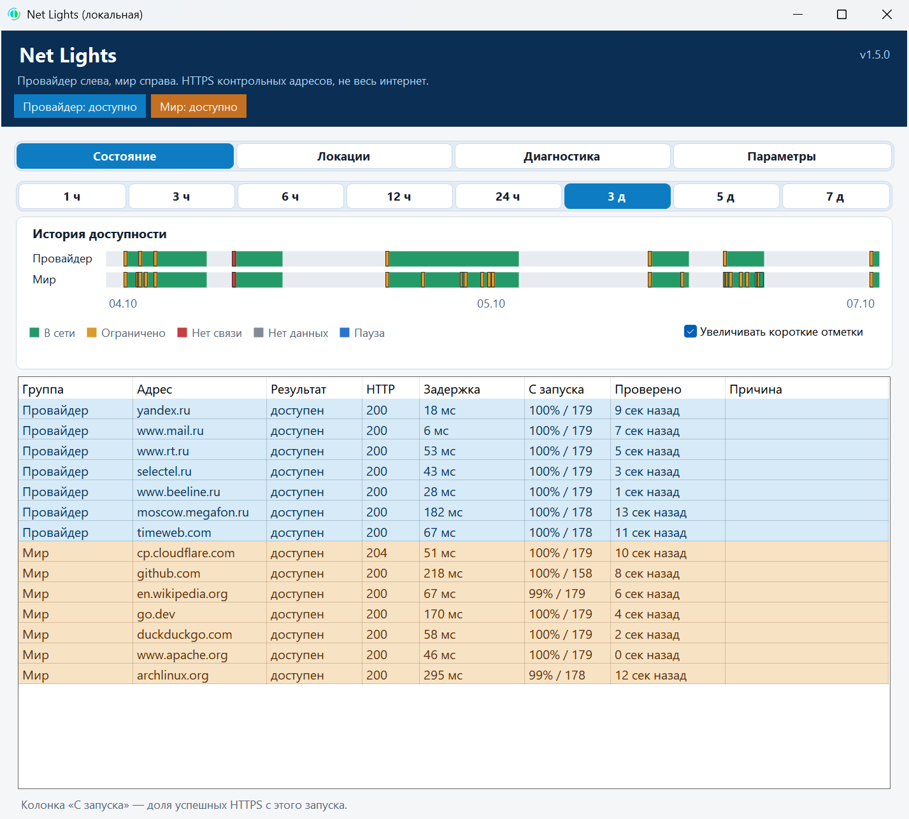
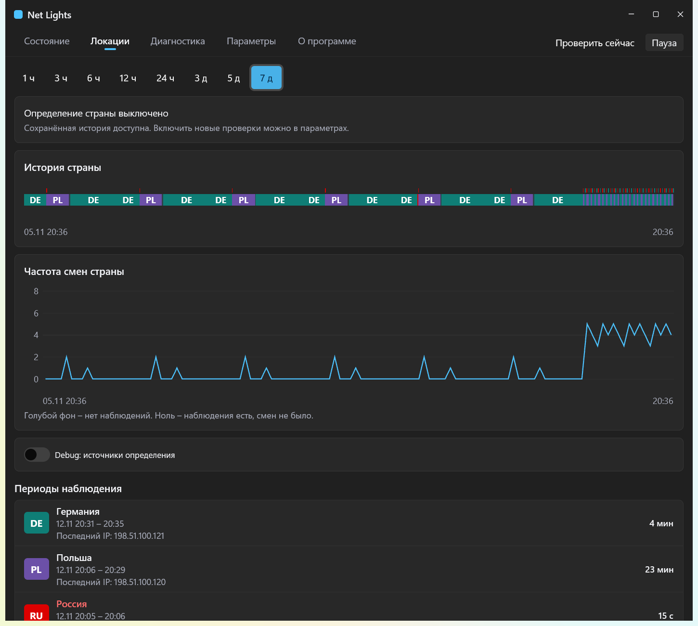

<p align="center">
  
</p>

<h1 align="center">Net Lights</h1>

<p align="center">
  Мониторинг доступности контрольных адресов в трее Windows 11.<br />
  Круг из двух половин: слева провайдер, справа мир.
</p>

<p align="center">
  <a href="https://github.com/AryaPaw/net-lights/releases/latest"></a>
  <a href="https://github.com/AryaPaw/net-lights/actions/workflows/ci.yml"></a>
  
  
  
</p>

<p align="center">
  <a href="#как-пользуются">Как пользоваться</a>
  &nbsp;|&nbsp;
  <a href="#установка">Установка</a>
  &nbsp;|&nbsp;
  <a href="#сборка">Сборка</a>
</p>

Net Lights проверяет заданные контрольные адреса по HTTPS HEAD. Это показывает доступность этих адресов, а не всего интернета. Программа не меняет системные DNS, маршруты или сертификаты. Цвет каждой половины свой:

- **зелёный** — доступно (не меньше двух независимых подтверждений)
- **жёлтый** — ограничено (только одно подтверждение)
- **красный** — нет ответа
- **серый** — нет свежих данных
- **синий** — пауза в меню значка, обе половины

## Окно

Один щелчок по значку открывает окно. Кнопка закрытия прячет его обратно в трей; чтобы завершить работу, выберите «Выход» в меню значка.

<p align="center">
  
</p>

## Локации

На вкладке «Локации» показаны история страны внешнего IP и частота её смен за выбранный период: 1, 3, 6, 12 или 24 часа, 3, 5 или 7 дней. При нормальной связи основной онлайн-источник `country.is` опрашивается каждые 10 секунд; после ошибок повторы реже. Если от него нет пригодного ответа, используется резервный `ipwho.is`. Базы V2Fly и IPLocate работают локально только для сравнения и не подменяют основной результат.

Точное время смены страны между проверками неизвестно. Чтобы посмотреть отдельные диагностические результаты источников, раскройте раздел «Debug · Источники определения» под графиками; по умолчанию он свёрнут.

<p align="center">
  
</p>

<p align="center"><em>На снимке адреса IP из истории скрыты.</em></p>

## Как пользуются

1. Скачайте установщик со страницы [Releases](https://github.com/AryaPaw/net-lights/releases/latest).
2. Запустите его. Права администратора не нужны.
3. Значок появляется в трее. По умолчанию программа запускается вместе с Windows; автозапуск можно выключить в «Параметрах».

Если включено автообновление, программа получает установщик с GitHub и запускает его в фоне. Настройка «Ставить обновления с GitHub» находится в «Параметрах».

## Установка

Нужна **Windows 11 x64**. Отдельный .NET Runtime не нужен, права администратора для установки не требуются. Файл: `NetLights-Setup-win-x64-*.exe`.

## Интервалы проверок и трафик

В «Параметрах» в блоке «Проверки и трафик» можно выбрать интервал доступности от 2 секунд до 5 минут. По умолчанию – 5 секунд для каждой группы; сайты внутри группы проверяются по очереди. Выбор сохраняется и применяется без перезапуска. При сбоях, запуске и смене сети возможны дополнительные проверки для подтверждения состояния. Более редкий опрос снижает трафик, но увеличивает задержку обнаружения изменений.

Интервал определения страны настраивается отдельно: 10, 15, 30 или 60 секунд. Счётчики в «Трафик по источникам» показывают переданные и полученные данные соединений с запуска, включая TLS. История этих счётчиков не хранится. Загрузки обновлений программы, DNS и служебные пакеты TCP/IP в них не входят.

## Сборка

Для сборки нужен [.NET SDK](https://dotnet.microsoft.com/download/dotnet/10.0) 10. Из корня репозитория `run-local.cmd` публикует и запускает локальную копию.

```ps1
dotnet test tests/NetLights.UnitTests/NetLights.UnitTests.csproj -c Release
dotnet publish src/NetLights.App/NetLights.App.csproj -c Release -r win-x64 --self-contained true -p:PublishSingleFile=true -o artifacts/publish
```

[GPL-3.0](LICENSE)
